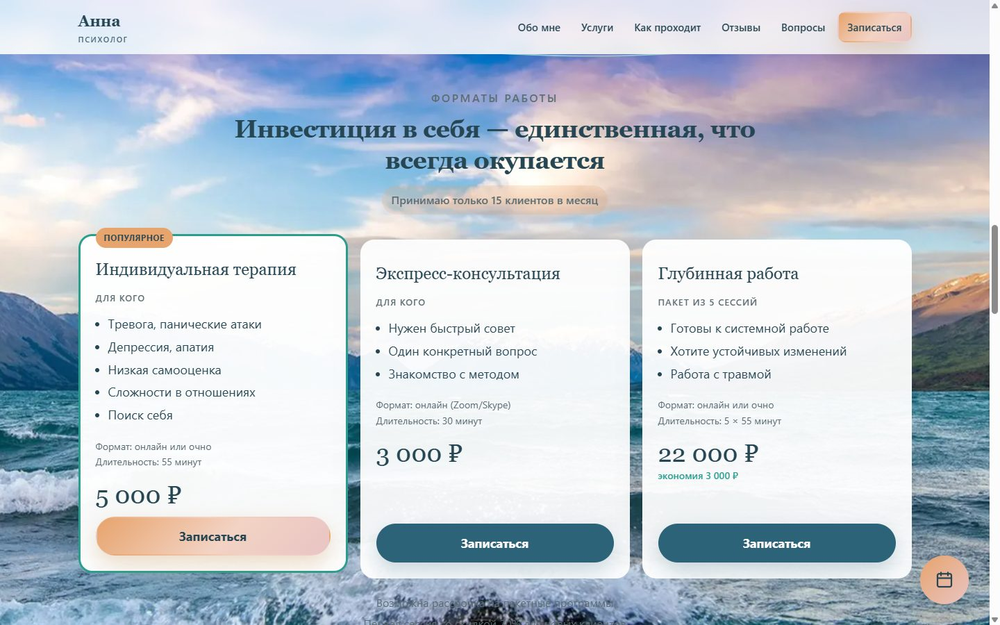
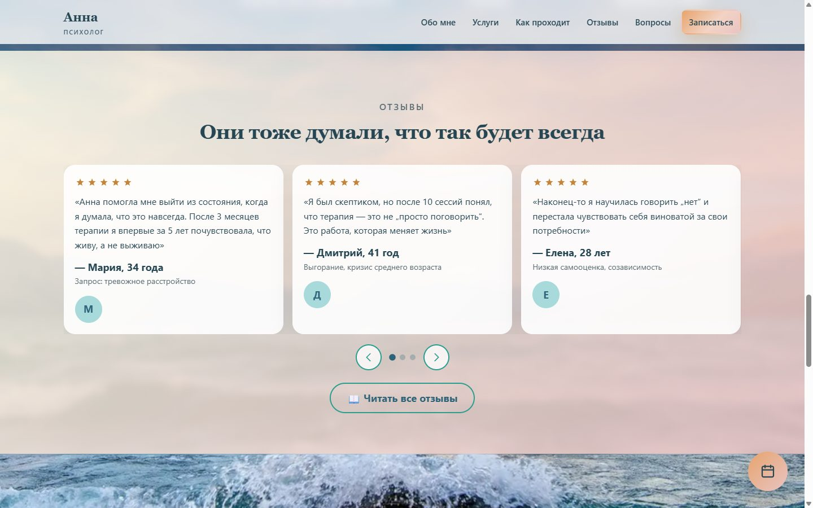
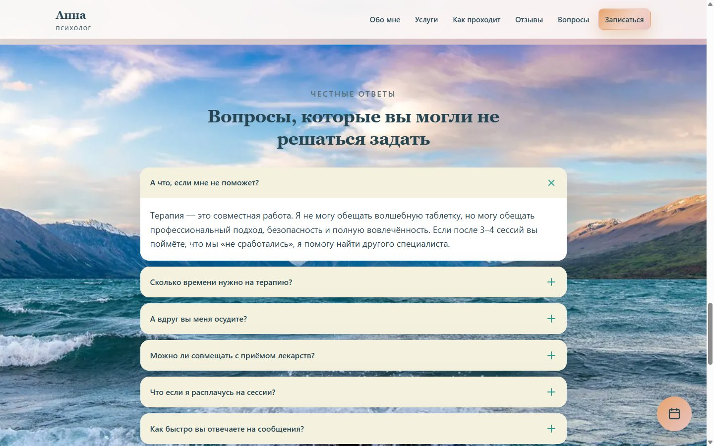
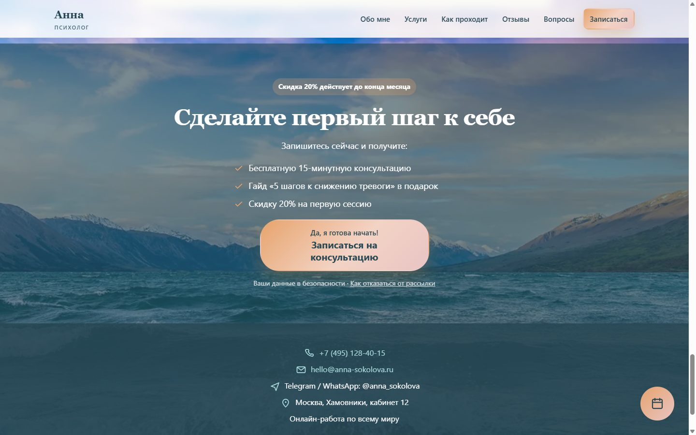
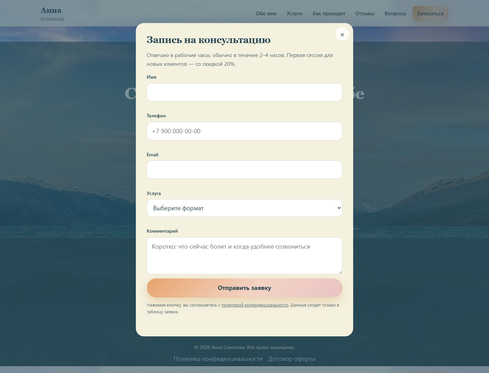

# Лендинг психолога

Одностраничный сайт для записи на консультацию. Спокойная витрина на фоне горного озера: услуги, цены, процесс, отзывы, вопросы и форма заявки.

Страницы статические. Сборки нет: достаточно открыть сайт через локальный сервер или выложить папку на любой хостинг статики.

## Как выглядит

Скриншоты сняты с работающей страницы: широкий экран и телефон.

### Главный экран


### Обо мне


### Услуги и цены



### Как проходит терапия


### Отзывы



### Вопросы



### Запись





### Телефон


## Как открыть локально

Файл `index.html` не открывайте двойным щелчком: из папки на диске страница и форма работают неполно. Запустите сервер из папки проекта.

1. Откройте PowerShell.
2. Перейдите в папку проекта:

```powershell
cd путь\к\папке\проекта
```

3. Запустите сервер:

```powershell
python -m http.server 8765
```

Если команда `python` не находится, используйте `py -m http.server 8765`.

4. Откройте в браузере [http://localhost:8765](http://localhost:8765).

Окно PowerShell оставьте открытым, пока смотрите сайт. Остановка: `Ctrl+C`.

## Структура

```
index.html              главная страница
privacy.html            политика конфиденциальности
offer.html              оферта
guide.html              материал «5 шагов к снижению тревоги»
css/style.css           оформление
js/main.js              меню, анимации, слайдер, проверка и отправка формы
js/config.js            адрес приёма заявок
assets/                 фон, портрет, картинка для соцсетей
docs/screenshots/       скриншоты страницы для этого README
google-apps-script/     скрипт, который пишет заявки в Google Таблицу
  Code.gs
  appsscript.json
```

## Куда падают заявки

Форма на сайте отправляет имя, телефон, почту, услугу, комментарий и адрес страницы на веб-приложение Google Apps Script. Адрес этого приложения записан в `js/config.js`, поле `googleScriptUrl`.

Скрипт привязан к Google Таблице клиента и добавляет новую строку:

| Дата | Имя | Телефон | Email | Услуга | Комментарий | Страница |
| --- | --- | --- | --- | --- | --- | --- |

Строка попадает на лист с именем «Заявки». Если такого листа нет, запись идёт на первый лист книги. Скрытое поле «Компания» в таблицу не пишется: оно отсекает автоматические отправки.

Пока в `js/config.js` пустой адрес, форма на сайте не отправляется и предлагает написать лично.
